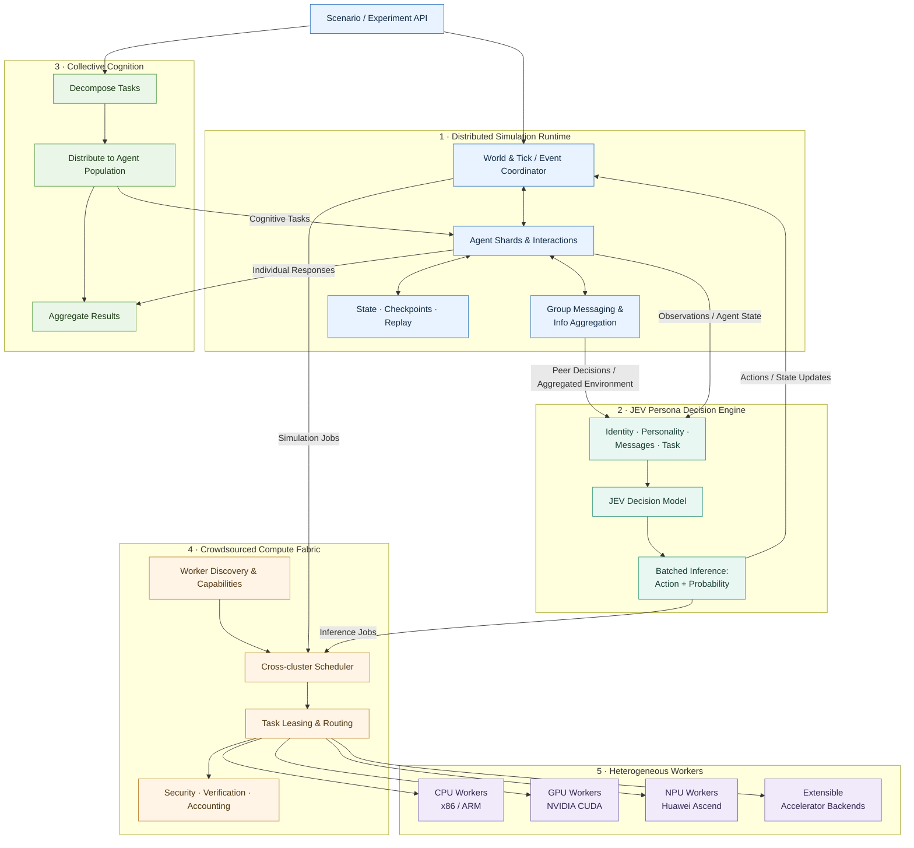

# PANTHEON

**A heterogeneous infrastructure for billion-scale multi-agent social simulation**


*A joint project by **CUHKSZ** and **SLAI**.*

> **Status: early-stage research / engineering prototype.** One billion active agents and sub-50 ms persona decisions are research targets, **not achieved benchmarks**. Current Python implementation is a CPU-only reference.

PANTHEON is a joint project by CUHKSZ and SLAI, developed under FreedomIntelligence, to connect independently operated **x86/ARM CPUs, NVIDIA CUDA GPUs, Huawei Ascend NPUs**, and extensible accelerator backends into a coherent fabric for vast populations of autonomous, persona-conditioned agents.

Unlike conventional LLM agent orchestration, PANTHEON decouples: (1) *agent identity / evolving state*, (2) *lightweight learned decisions* (the JEV model), (3) *placement across heterogeneous hardware*, (4) *trusted crowdsourced resource sharing*, and (5) *collective cognition over large agent populations*.

## Why this project?

Large-scale social simulation is constrained by fragmented compute, prohibitively expensive LLM calls per decision, and costly coordination between millions or billions of interactive entities. Our thesis: **small persona-conditioned decision models + heterogeneous hardware + crowdsourced execution + distributed simulation + collective cognition** can make otherwise intractable world-scale social experiments feasible.

## Five pillars

| Pillar | Objectives |
|---|---|
| **Heterogeneous Compute Fabric** | CPU (x86/ARM), NVIDIA CUDA, Huawei Ascend (CANN / torch-npu), future backend adapters; scheduling, placement, batching; efficient information flow across heterogeneous resources |
| **JEV Persona Decision Engine** | Compact policy conditioned on identity + personality + interaction messages + task, outputting an action and its probability; distillation, uncertainty calibration; **p95 <50 ms aspiration under a clearly defined workload** |
| **Crowdsourced Compute Protocol** | Capability advertising, task leases, identity, attestation, sandboxing, accounting, verification, opt-in sharing |
| **Collective Cognition** | A general collective cognition mechanism: **decompose — distribute — aggregate**; cognitive tasks distributed to large, behaviorally diverse agent populations, results aggregated by explicit rules |
| **Distributed Simulation Core** | Sharded agents, efficient environment information aggregation, fast intra-group agent communication channels, event and agent-state management, ticks/discrete events, deterministic replay, checkpoints |

## Conceptual architecture

PANTHEON separates **simulation semantics**, **fast persona-conditioned decisions**, **collective cognition**, and **crowdsourced heterogeneous execution**. The simulation coordinator owns world consistency; a federated control plane discovers resources and leases work to eligible workers; device-specific backends execute simulation and inference tasks.



**Core design principles**

- **Simulation at scale:** partition agent populations and world state, exchange events, and support deterministic checkpoints and replay.
- **Fast personalized decisions:** use compact persona-conditioned JEV policies with batched inference; **p95 < 50 ms is a research target for a specified inference workload**, not an achieved end-to-end simulation latency.
- **Efficient information flow:** aggregate environment information at scale, give agents fast channels to peer decisions within their group, and move data efficiently across heterogeneous compute resources.
- **Crowdsourced compute:** federate independently contributed clusters through capability discovery, scheduling, bounded leases and verifiable execution.
- **Collective cognition:** decompose–distribute–aggregate over model populations: cognitive tasks are decomposed, distributed to behaviorally diverse agents, and individual results aggregated under explicit rules.
- **Hardware portability:** route work across x86/ARM CPU, NVIDIA CUDA GPU, Huawei Ascend NPU, and future backends without assuming identical accelerator toolchains.
- **Trust by design:** isolate untrusted workers and keep sensitive agent profiles on authorized compute only.

*The diagram describes the target architecture. The current codebase contains a local CPU reference simulator; distributed scheduling, real JEV inference, and hardware-specific execution are planned.*

## The JEV decision model

The core decision unit of PANTHEON is the **JEV model**: a compact, persona-conditioned policy trained to make fast decisions for individual agents in social simulation.

**Inputs:**

- **Identity & personality** — the agent's synthetic or permissioned persona profile (stable traits, demographics, preferences).
- **Interaction & communication context** — recent decisions of other agents (e.g. peers in the same group) and aggregated environment information.
- **Task** — the decision task or scenario currently presented to the agent.

**Outputs:** an **action** together with its **probability** — a calibrated distribution over the action space, not free-form text.

Formally, given identity/personality `p`, interaction messages `m_t`, aggregated environment information `e_t`, agent state `s_t` and task `τ`, infer **P(action_t | p, m_t, e_t, s_t, τ)**. JEV models are developed as fast, calibrated small models distilled from more expensive teachers, avoiding one large-model call per agent per tick.

**Performance target:** p95 <50 ms for one specified inference configuration (batch, inputs, device), independently benchmarked for each hardware backend. Do not confuse per-decision inference latency with a global simulation tick SLA.

JEV only produces actions and probabilities — it is the fast behavioral layer. Simulating a person also means simulating their **language**, not only their decisions; natural-language social simulation, where JEV decisions are combined with LLM-based language generation, is a planned future direction (see Roadmap).

This does not claim to reliably forecast any specific real person's behavior. Use synthetic, consented, or appropriately de-identified data, with privacy-preserving evaluation and safeguards against sensitive individual profiling.

## Collective cognition over model populations

PANTHEON treats collective cognition as a **general mechanism for group-level intelligence**: **decompose — distribute — aggregate**. A cognitive task is decomposed into subtasks, distributed to a large, behaviorally diverse population of agents, and the individual results are aggregated under explicit rules.

This mirrors the structure of distributed human problem-solving — task distribution, individual differences, aggregation rules — but **the supply side consists of models rather than humans**. Because each agent carries its own persona and makes independent JEV decisions, population-level aggregates can capture diversity of responses rather than a single model's average answer, enabling fast social experiments such as opinion dynamics, judgment aggregation, and survey-like studies at scales impractical with human participants.

## Simulation infrastructure

The distributed simulation core is built around four infrastructure capabilities:

- **Efficient environment information aggregation** — roll up agent states and actions into environment-level information at scale.
- **Fast agent communication channels** — an agent can quickly observe the decisions of other agents in its group.
- **Cross-resource information flow** — move simulation and inference data efficiently between CPU, GPU and NPU workers.
- **Event and state management** — efficient environment event handling and agent state management, with deterministic replay and checkpoints.

## Crowdsourced compute infrastructure

Participants advertise capabilities and policies; coordinators assign bounded signed work using expiring leases and backpressure; workers execute isolated simulation shards and submit audited outputs. Build in membership, heartbeats, checksum-based artifacts, workload/data classifications, reproducible checkpoints, probabilistic verification and utilization accounting. **Never send private real-person profiles to untrusted crowd nodes by default.**

See [Protocol](docs/CROWD_PROTOCOL.md), [Architecture](docs/ARCHITECTURE.md), and [Persona Engine](docs/PERSONA_ENGINE.md).

## Quickstart — CPU reference only

```bash
python -m venv .venv
source .venv/bin/activate
pip install -e '.[dev]'
python examples/local_simulation.py
python -m pytest
```

The example simulates synthetic agents locally with a deterministic toy policy. It is not a throughput or latency benchmark.

## Roadmap

1. **Phase 0:** stable schemas, local CPU simulator, reproducible benchmark.
2. **Phase 1:** capability-aware CUDA / Ascend backend integration, batch JEV inference.
3. **Phase 2:** cross-cluster leasing and crowdsourcing, isolation, result verification, checkpoint/replay.
4. **Phase 3:** trained small JEV persona policies, quality / calibration / latency evaluations.
5. **Phase 4:** collective cognition experiments — decompose–distribute–aggregate over large persona-conditioned agent populations.
6. **Phase 5:** natural-language social simulation (future direction) — combine fast JEV behavioral decisions with LLM-based language generation, since simulating a person means simulating both their language and their behavior.
7. **Phase 6:** progressively larger, explicitly measured scale-out experiments toward 10^9 active agents.

See [Roadmap](docs/ROADMAP.md).

## Scope and limitations

- No current claim of a production billion-agent runtime, multi-vendor kernel parity, or universal 50 ms SLA.
- Natural-language social simulation is an exploratory future direction, not a current capability.
- No unpermissioned code execution or sharing of confidential datasets across volunteer nodes.
- A contributor code of conduct, project governance, and a suitable license should be chosen before a broader open-source release.

## Contributing

Community help is welcome in distributed simulation, Ascend, CUDA, efficient inference, scheduling, benchmark design, collective cognition experiment design, security and privacy. See [CONTRIBUTING.md](CONTRIBUTING.md).

Maintained under [FreedomIntelligence](https://github.com/FreedomIntelligence).
