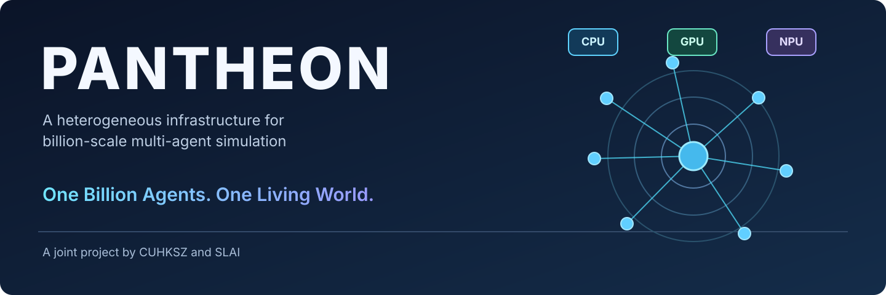
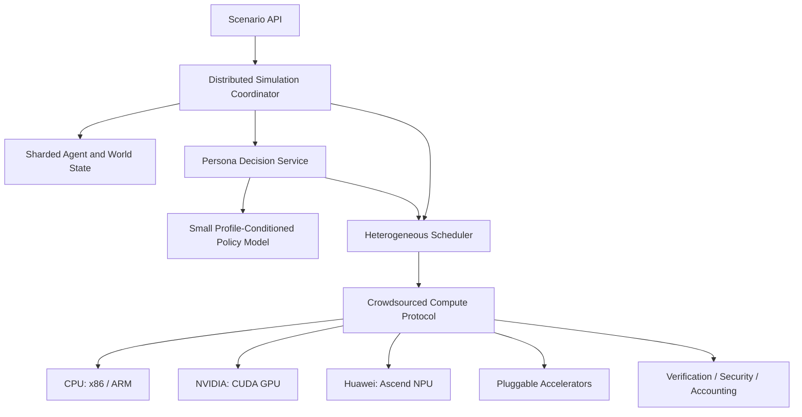

# PANTHEON

**A heterogeneous infrastructure for billion-scale multi-agent simulation**



*A joint project by **CUHKSZ** and **SLAI**.*

> **Status: early-stage research / engineering prototype.** One billion active agents and sub-50 ms persona decisions are research targets, **not achieved benchmarks**. Current Python implementation is a CPU-only reference.

PANTHEON is a joint project by CUHKSZ and SLAI, developed under FreedomIntelligence, to connect independently operated **x86/ARM CPUs, NVIDIA CUDA GPUs, Huawei Ascend NPUs**, and extensible accelerator backends into a coherent fabric for vast populations of autonomous, persona-conditioned agents.

Unlike conventional LLM agent orchestration, PANTHEON decouples: (1) *agent identity / evolving state*, (2) *lightweight learned decisions*, (3) *placement across heterogeneous hardware*, and (4) *trusted crowdsourced resource sharing*.

## Why this project?

Large-scale simulation is constrained by fragmented compute, prohibitively expensive LLM calls per decision, and costly coordination between millions or billions of interactive entities. Our thesis: **small persona-conditioned decision models + heterogeneous hardware + crowdsourced execution + distributed simulation** can make otherwise intractable world-scale experiments feasible.

## Four pillars

| Pillar | Objectives |
|---|---|
| **Heterogeneous Compute Fabric** | CPU (x86/ARM), NVIDIA CUDA, Huawei Ascend (CANN / torch-npu), future backend adapters; scheduling, placement, batching |
| **Persona Decision Engine** | Compact profile-conditioned behavioral policy, distillation, uncertainty calibration; **p95 <50 ms aspiration under a clearly defined workload** |
| **Crowdsourced Compute Protocol** | Capability advertising, task leases, identity, attestation, sandboxing, accounting, verification, opt-in sharing |
| **Distributed Simulation Core** | Sharded agents, state and events, social interactions, ticks/discrete events, deterministic replay, checkpoints |

## Conceptual architecture



*This is a target architecture. Remote worker execution and accelerator inference are not yet implemented.*

## Persona decision model

Given a synthetic or permissioned profile `p`, observation `o_t`, agent state `s_t` and history `h_t`, infer **P(action_t | p, o_t, s_t, h_t)**. Develop fast, calibrated small models distilled from more expensive teachers, avoiding one large-model call per agent per tick.

**Performance target:** p95 <50 ms for one specified inference configuration (batch, inputs, device), independently benchmarked for each hardware backend. Do not confuse per-decision inference latency with a global simulation tick SLA. The mentioned JEB-style decision model remains an interface placeholder until its exact reference is identified.

This does not claim to reliably forecast any specific real person's behavior. Use synthetic, consented, or appropriately de-identified data, with privacy-preserving evaluation and safeguards against sensitive individual profiling.

## Crowdsourced infrastructure

Participants advertise capabilities and policies; coordinators assign bounded signed work using expiring leases and backpressure; workers execute isolated simulation shards and submit audited outputs. Build in membership, heartbeats, checksum-based artifacts, workload/data classifications, reproducible checkpoints, probabilistic verification and utilization accounting. **Never send private real-person profiles to untrusted crowd nodes by default.**

See [Protocol](docs/CROWD_PROTOCOL.md), [Architecture](docs/ARCHITECTURE.md), and [Persona Engine](docs/PERSONA_ENGINE.md).

## Quickstart — CPU reference only

```bash
python -m venv .venv
source .venv/bin/activate
pip install -e '.[dev]'
python examples/local_simulation.py
python -m pytest
```

The example simulates synthetic agents locally with a deterministic toy policy. It is not a throughput or latency benchmark.

## Roadmap

1. **Phase 0:** stable schemas, local CPU simulator, reproducible benchmark.
2. **Phase 1:** capability-aware CUDA / Ascend backend integration, batch persona inference.
3. **Phase 2:** cross-cluster leasing and crowdsourcing, isolation, result verification, checkpoint/replay.
4. **Phase 3:** trained small persona policies, quality / calibration / latency evaluations.
5. **Phase 4:** progressively larger, explicitly measured scale-out experiments toward 10^9 active agents.

See [Roadmap](docs/ROADMAP.md).

## Scope and limitations

- No current claim of a production billion-agent runtime, multi-vendor kernel parity, or universal 50 ms SLA.
- No unpermissioned code execution or sharing of confidential datasets across volunteer nodes.
- A contributor code of conduct, project governance, and a suitable license should be chosen before a broader open-source release.

## Contributing

Community help is welcome in distributed simulation, Ascend, CUDA, efficient inference, scheduling, benchmark design, security and privacy. See [CONTRIBUTING.md](CONTRIBUTING.md).

Maintained under [FreedomIntelligence](https://github.com/FreedomIntelligence).
